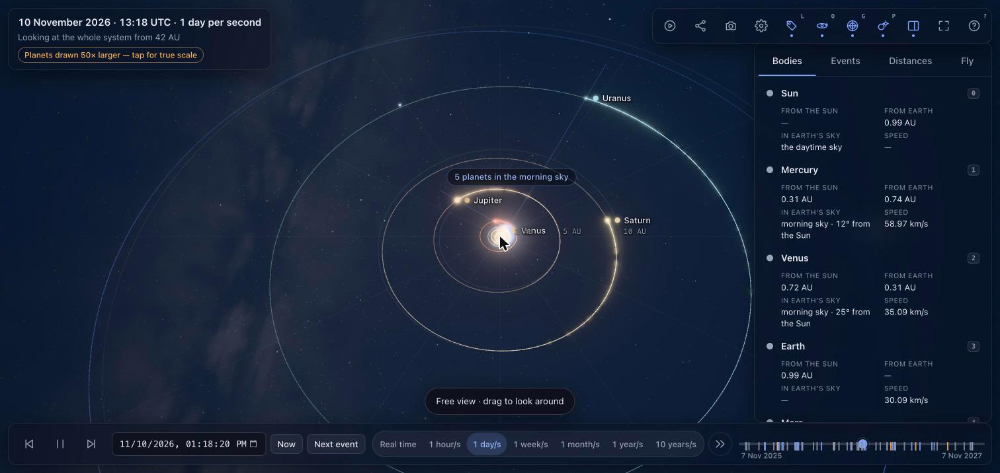
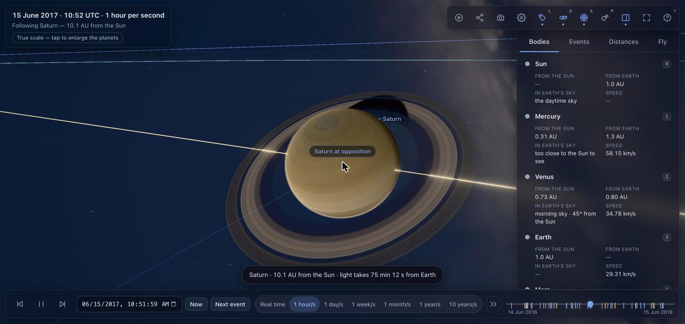
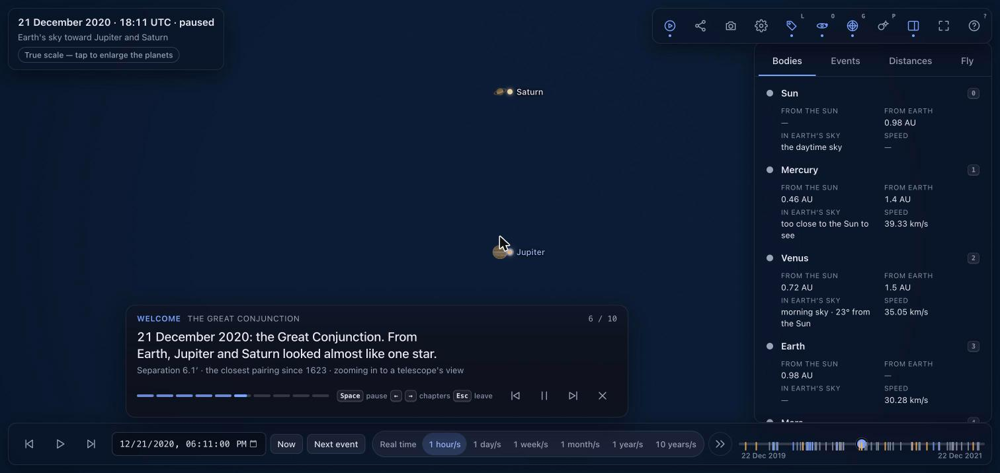
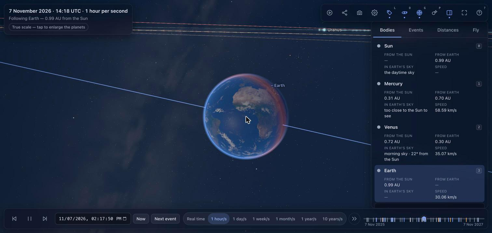
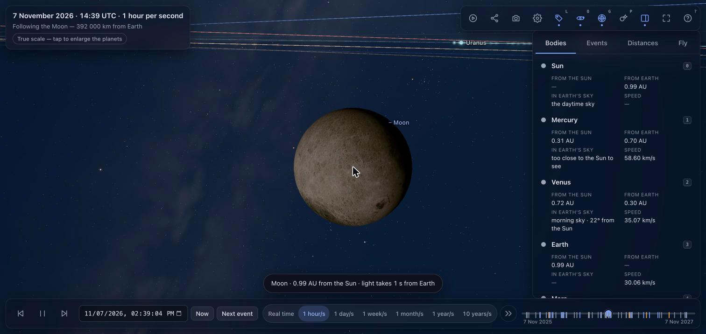

# Solar Map

The real solar system, computed live in your browser: where every planet and the Moon are for any date from 4000 BC to
AD 4000, how far everything is, the alignments and eclipses worth watching, and cinematic faster-than-light flights
between the worlds — with guided tours for a first visit and a scientist mode underneath.

Run it locally with `npm install && npm run dev`, or view the site at [Solar Map](https://sonoransun.github.io/solarmap/).

The map is computed, not animated: every position, distance, alignment time, rotation phase, magnitude and eclipse
comes from the VSOP87A planetary theory, Meeus's lunar theory and the IAU rotation models evaluated in double
precision, and is checked against JPL Horizons in the test suite.











## What it does

- **Guided tours.** A story engine plays five curated tours — *Welcome* (on first load), *The planets*, *Alignments*,
  *Scale & light* and *Seasons* — as captioned chapters with a progress bar, pause / next / previous / leave, keyboard
  control and screen-reader announcements. Every date a tour visits is a verified instant from the test fixtures, every
  number in a caption is computed live for the moment shown, and touching the scene pauses a tour instead of killing it.
  Tours live under the ▶ button; the Welcome tour can be switched off in Settings.
- **A real sky.** 8 404 stars of the Yale Bright Star Catalogue (V ≤ 6.5) at their J2000 positions with catalogue
  colours and magnitudes, a Milky Way band on the true galactic plane, the brightest stars named in the sky view.
- **Orientation across time.** The Sun, eight planets and the Moon for any date from 4000 BC to AD 4000, with true
  axial tilt and spin phase (IAU WGCCRE 2015 elements; Earth from sidereal time, precession and nutation). Play, scrub,
  or type a date; rates from real time to ten years per second, eased so nothing ever jumps.
- **The Moon.** Meeus's abridged ELP-2000/82 (chapter 47), verified against JPL DE441 to 10″ and 19 km across
  1600–2600 and a 2024–2027 grid; phases, perigee and apogee, and solar and lunar eclipses as events.
- **Relative distances.** A live table from the selected body to every other one in AU, million km and light-time,
  plus an on-scene beam with a two-line readout (distance and light travel time).
- **Notable alignments.** Oppositions, inferior and superior conjunctions, greatest elongations, planet–planet close
  approaches, transits, Earth–planet closest approaches, perihelia and aphelia, heliocentric parades, geocentric
  "planet parades", equinoxes and solstices, lunar phases and eclipses — found by scanning the ephemeris and refining
  with Brent's method to the second, ranked by notability, explained in one sentence each ("why it matters"), listed with
  *Set time* / *Show me*, marked on the timeline, and drawn in the scene.
- **Theatrical fly-bys.** A log-speed profile gives about a second of visible sub-light departure and arrival on every
  hop, peaks of hundreds to tens of thousands of × c, continuous velocity and acceleration, star-streak warp, a
  light-speed beat as the camera crosses c, and arrival into a follow view. Every other camera move is an animated
  glide: sky views from Earth zoom down to a 0.25° telescope field, framings centre their subject above the caption bar.
- **Lay first, scientist underneath.** The HUD reads "8 November 2026 · 18:19 UTC · 1 day per second"; the Bodies tab
  speaks in words (day length, year length, light-time, phase, brightness, apparent size). *Scientist mode* (Settings)
  adds JD, TT = UTC + ΔT, the frame, astrometric J2000 and apparent-of-date RA/Dec, osculating orbital elements, the
  orientation elements, the raw notability filter and symbols.
- **Share and save.** The Share button copies a link that restores the instant, selection and camera; Snapshot saves
  the frame as a PNG.
- **In your browser.** A static site: no server, no runtime API calls, no tracking.

## Precision

Positions come from VSOP87A (Bretagnon & Francou 1988) rotated into the JPL "Ecliptic of J2000.0" frame. Measured
against JPL Horizons (DE441) over 1900–2100, after that rotation:

| Body | Position residual | Angular |
|---|---|---|
| Mercury, Venus, Earth | ≤ 20–25 km | ≤ 0.05″ |
| Mars | ≤ 150 km | ≤ 0.15″ |
| Jupiter, Saturn | ≤ 2,000 km | ≤ 0.5″ |
| Uranus | ≤ 20,000 km | ≤ 1.5″ |
| Neptune | ≤ 60,000 km | ≤ 3.0″ |
| Moon (geocentric, Meeus ch. 47) | ≤ 19 km | ≤ 10.5″ (1600–2600: ≤ 6″) |

Uranus and Neptune are limited by VSOP87 itself, which was fitted to DE200: that error is intrinsic to the theory,
grows outside 1600–2600, and is stated in the app's Help › About panel rather than hidden.

Derived quantities, measured against JPL Horizons observer and element tables (2020–2027):

| Quantity | Residual |
|---|---|
| Astrometric RA/Dec (J2000, light-time) | ≤ 0.06″ Mercury–Mars, ≤ 0.25″ Jupiter/Saturn, ≤ 1.4″ Uranus/Neptune (the VSOP87 errors above) |
| Apparent RA/Dec (of date: aberration, precession, nutation) | ≤ 0.22″ inner planets, ≤ 0.41″ Jupiter, ≤ 1.5″ Neptune |
| Apparent magnitude (Mallama & Hilton 2018) | ≤ 0.02 mag (Mars 0.10 mag: its rotational and seasonal terms are not modelled) |
| Osculating elements (from the VSOP87 state) | a ≤ 2 × 10⁻⁷ AU Mars, ≤ 1.3 × 10⁻⁶ AU Jupiter; angles ≤ 0.0007° |
| Equinoxes and solstices (apparent λ☉) | ≤ 0.5 min of the USNO 2025–2026 instants |
| Solar and lunar eclipses (greatest eclipse) | ≤ 9 s of the NASA Five Millennium Canon, γ to 0.0003, magnitude to 0.004 |
| Lunar phases · perigee/apogee | ≤ 0.5 min of USNO · ≤ 11 min / 41 km of Horizons |
| Nutation · GAST | Δψ, Δε to 0.001″ and GAST to 0.0001 s of Meeus's worked examples |

Alignment event times are geometric (no light-time or aberration): oppositions and conjunctions differ from almanac
"apparent" times by 6–40 minutes, greatest elongations by up to a few hours, while the angles agree to 0.002°.
Stationary points use the apparent longitude of date. Every tolerance in the test suite is 1.3 × the measured
residual or the documented requirement, whichever is larger, and is stated in the assertion message.

Time: JD(UTC) is the single source of truth; the ephemeris is evaluated at TT using the IERS leap-second table
through its expiry (2027-06-28) and Espenak–Meeus polynomials outside it, with TDB applied to the series argument.

## Verification

```bash
npm test          # node --test, no browser needed
```

The suite checks the generated series against the official VSOP87 check file, the rotated positions and velocities
against committed JPL Horizons fixtures (per body and per epoch band), the Moon against 547 Horizons states (including
seven eclipse instants), ΔT against USNO values, the IAU orientation model against NSSDC obliquities and
Horizons-derived sub-solar points, nutation and GAST against Meeus's worked examples, apparent places and magnitudes
against Horizons observer tables, osculating elements against Horizons element tables, roughly forty reference
alignments (Mars opposition 2025-01-16 02:31 UTC, the 2020 great conjunction at 6.1′, Mars's 2003 closest approach at
55,758,006 km, and more) against Horizons-derived instants and published almanacs, every tour date against those
fixtures, the fly-by profile's integral and continuity, the camera glide laws, the star catalogue (Sirius, Vega,
Polaris, Regulus) and the simulation clock for drift over a million frames.

Regenerate the data (the scripts are rate-limited and cache their downloads; the app itself never calls them):

```bash
npm run data:vsop87     # IMCCE VSOP87A → src/astro/data/vsop87a.js + fixtures
npm run data:horizons   # JPL Horizons  → test/fixtures/horizons/*.json
npm run data:moon       # JPL Horizons  → test/fixtures/horizons/moon.json (geocentric Moon, eclipse instants)
npm run data:stars      # Yale BSC5     → src/astro/data/stars.js
npm run data:observer   # JPL Horizons  → observer / element / ring / libration fixtures for the scientist quantities
npm run ephem -- 2026-09-13T12:00:00Z   # print states, sub-solar point and residuals
```

## Build and deploy

```bash
npm run dev       # http://localhost:5173
npm run build     # → docs/ (GitHub Pages: Settings → Pages → main /docs)
npm run preview
```

`index-nobuild.html` runs the same sources with an import map and no build step.

## Controls

Space play/pause (or pause a tour) · `[` `]` rate · ← → ∓1 day (Shift 7 d, Alt 1 year; in a tour: previous / next
chapter) · `T` now · `0`–`8` select Sun…Neptune · `F` fly to selection · `V` sky view from Earth · `Esc` leave a
tour / cancel a flight / close dialogs · `Home` reset view · `L`/`O`/`G` labels, orbits, grid · `P` planet size ·
`?` help. Click a body or its label to select, double-click to fly, shift-click for the distance beam; drag to orbit,
pinch or scroll to zoom. The Help dialog lists gestures, explains what you are looking at, and holds About & sources.

## Sources

Data and licences are listed in [LICENSES.md](LICENSES.md): VSOP87 (IMCCE), JPL Horizons, IAU WGCCRE 2015,
IERS/USNO time scales, NASA NSSDC parameters, Meeus's *Astronomical Algorithms* (lunar theory, nutation, apparent
places), Mallama & Hilton 2018 (planetary magnitudes), the Yale Bright Star Catalogue, Solar System Scope surface
maps (CC BY 4.0), webgl-noise (MIT), three.js (MIT).
